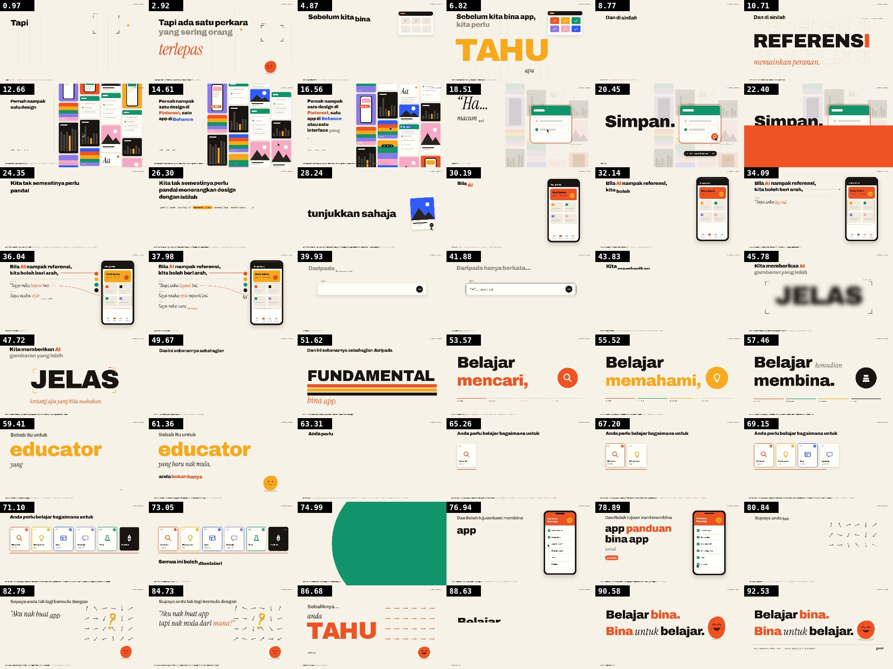

# Video tipografi gemi: referensi, skill, dan video



| Folder | Isi |
|---|---|
| [`projects/gemi-referensi-remake/`](projects/gemi-referensi-remake/) | **Video jadi**: [`out/gemi-referensi-remake.mp4`](projects/gemi-referensi-remake/out/gemi-referensi-remake.mp4). 1920×1080 landscape, 30 fps, 93,5 detik, Bahasa Melayu, suara saja tanpa musik, −16 LUFS |
| [`.claude/skills/video-tipografi-melayu/`](.claude/skills/video-tipografi-melayu/) | **Skill Claude**: engine tipografi kinetik, maskot Si Bulat, script render MP4, dan panduan gaya. Otomatis aktif di setiap sesi Claude Code dalam repo ini |
| [`dist/video-tipografi-melayu.zip`](dist/video-tipografi-melayu.zip) | Skill yang sama dalam bentuk zip, untuk diunggah ke claude.ai (Settings → Capabilities → Skills) |
| [`references/opus-video-repos/`](references/opus-video-repos/) | Ringkasan 10 repo video Opus 5.5: tabel perbandingan, cek lisensi, dan salinan README asli |
| [`references/gemi-referensi-drive/`](references/gemi-referensi-drive/) | Ringkasan video referensi dari Google Drive (`video gemi/gemi-referensi`) |

## Membuat video baru dengan skill ini

Cukup minta ke Claude, misalnya: *"Buatkan video tipografi landscape Bahasa Melayu dari suara ini"*, lalu lampirkan file suaranya. Kalau sudah ada timing kata dari Whisper (`words.json`), lampirkan juga. Langkah manualnya:

```bash
S=.claude/skills/video-tipografi-melayu
sh $S/scripts/new_project.sh projects/video-baru suara.wav words.json 0.6   # siapkan proyek
# tulis STORYBOARD.md dan scenes.js (contoh lengkap: projects/gemi-referensi-remake/scenes.js)
node $S/scripts/render.mjs projects/video-baru grid 48                      # cek lembar kontak
node $S/scripts/render.mjs projects/video-baru mp4 --workers=4              # → out/video.mp4
```

Yang dibutuhkan: Node 20+, ffmpeg, dan Chrome atau Chromium (dengan Playwright). Untuk pratinjau, buka `index.html` di Chrome. Spasi untuk main/jeda, panah kiri/kanan untuk melompat.
