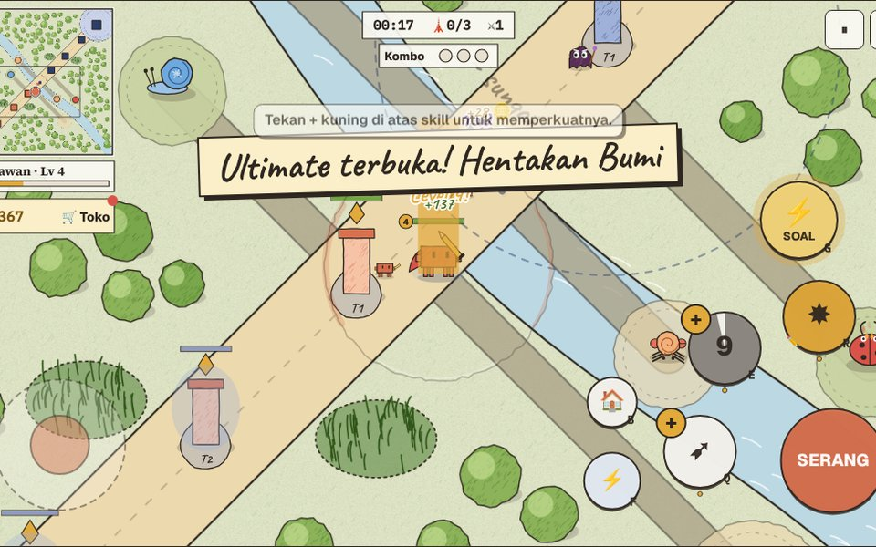

# Arena Clawd Pro (selesai, bisa dimainkan)



Game MOBA matematika main sendiri, lanjutan dari branch `arena-clawd-pro-wip` di `auzanhasfi/game-preview` (commit dasar `65ce044`). Musuhnya hanya minion dan menara.

| File | Isi |
|---|---|
| [`arena-clawd-pro-siap-upload/`](arena-clawd-pro-siap-upload/) | **Satu folder siap unggah**: `game-netlify/` (game untuk Netlify) + `prompt/` (prompt 3 bahasa + sampul) |
| [`arena-clawd-pro-siap-upload.zip`](arena-clawd-pro-siap-upload.zip) | Folder yang sama dalam zip |
| [`game/index.html`](game/index.html) | Game lengkap, satu file. Buka langsung di Chrome |
| [`game/game.html`](game/game.html) | Sumber (format Artifact). `sh game/build.sh` membuat `index.html` |
| [`game/LANJUTKAN.md`](game/LANJUTKAN.md) | Status, daftar 11 fitur yang sudah dibuat, langkah tersisa |
| [`game/PROMPT-id.md`](game/PROMPT-id.md) · [`ms`](game/PROMPT-ms.md) · [`en`](game/PROMPT-en.md) | Prompt detail untuk membuat game ini, untuk Prompt Generator |
| [`game/bukti/`](game/bukti/) | Tangkapan layar uji main otomatis HP 390×844 dan desktop, plus [`laporan.md`](game/bukti/laporan.md) |
| [`game/uji/`](game/uji/) | `senario.json` dan `jalankan.js` (Playwright) |
| [`game-preview.patch`](game-preview.patch) | Semua perubahan untuk repo game-preview (tanpa PNG bukti) |

## Unggah ke Netlify

- Cara mudah: app.netlify.com → Add new site → Deploy manually → seret folder `arena-clawd-pro-siap-upload/game-netlify/`.
- Lewat CLI: `cd projects/arena-clawd-pro/arena-clawd-pro-siap-upload/game-netlify && netlify deploy --dir . --prod`.
- Setelah mengubah `game/game.html`, buat ulang folder dan zip: `sh game/build-netlify.sh`. Prompt diambil dari `game/PROMPT-*.md`.

## Pratinjau di localhost

```bash
cd projects/arena-clawd-pro/arena-clawd-pro-siap-upload/game-netlify
python3 -m http.server 8765
# buka http://localhost:8765/
```

## Memasang ke repo game-preview (sesi ini tidak punya izin push ke sana)

```bash
cd game-preview
git checkout arena-clawd-pro-wip          # harus di commit 65ce044
git apply --index ../main/projects/arena-clawd-pro/game-preview.patch
cp -r ../main/projects/arena-clawd-pro/game/bukti kertas-tinta/games/arena-clawd-pro/
git commit -m "Arena Clawd Pro selesai" && git push
```

Patch ini menambah folder `kertas-tinta/games/arena-clawd-pro/` versi jadi, `sampul/arena-clawd-pro.jpg`, dan entri `arena-clawd-pro` di array `DATA` pada `index.html` akar (kategori Kertas & tinta). Setelah branch digabung ke `main`, game tampil di preview.edugamelabs.com.
