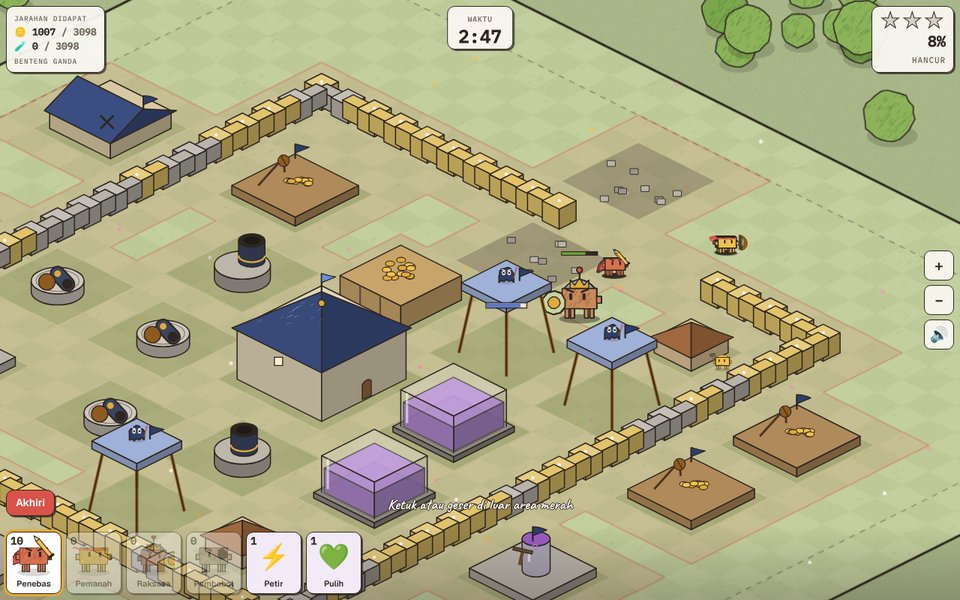

# Kubu Clawd (bisa dimainkan)



Game strategi desa bergaya kertas & tinta (siri Clawd), terinspirasi Clash of Clans, dengan kuis matematika di dalam permainan. Semua gambar dan nama dibuat sendiri; tidak memakai aset atau nama karakter Supercell.

| File | Isi |
|---|---|
| [`kubu-clawd-netlify/`](kubu-clawd-netlify/) | **Folder siap unggah ke Netlify**: `index.html`, `sampul.jpg`, `netlify.toml`, `robots.txt` |
| [`kubu-clawd-netlify.zip`](kubu-clawd-netlify.zip) | Folder yang sama dalam zip |
| [`game/game.html`](game/game.html) | Sumber (format Artifact). `sh game/build-netlify.sh` membuat ulang folder Netlify + zip |
| [`game/bukti/`](game/bukti/) | Tangkapan layar uji main otomatis (HP 390×844 dan desktop 1280×800) |

## Isi game

- **Desa isometrik 36×36**: Balai Desa (Lv 1–5), Tambang Emas, Pompa Tinta, Gudang Emas, Gudang Tinta, Barak, Kemah Pasukan, Pondok Tukang, Meriam, Menara Pemanah, Mortir, Tembok, Bom. Batas jumlah tiap bangunan naik mengikuti level Balai Desa.
- **Ekonomi**: emas, tinta ajaib, permata. Tambang dan pompa menghasilkan terus (juga saat game ditutup, maksimal 8 jam); ketuk gelembungnya untuk memanen. Kapasitas dibatasi gudang.
- **Tukang**: 2 tukang, bisa beli tukang ke-3 dan ke-4 dengan permata. Membangun dan menaikkan level butuh waktu.
- **Pasukan** (dilatih di Barak, ditampung di Kemah):
  - Penebas: menyerang bangunan terdekat.
  - Pemanah: menembak dari jauh.
  - Pencuri: mengincar sumber daya, damage 2×.
  - Raksasa: hanya mengincar pertahanan.
  - Pembobol Tembok: meledak di tembok, damage 40×.
- **Serangan**:
  - Pilihan kampung: Kampanye Comot 10 kampung (jarahan habis bila sudah diambil), atau Cari Lawan acak dengan tombol "Cari lagi".
  - Aturan: pasukan diturunkan di luar zona merah; waktu 3 menit.
  - Bintang: 50% hancur, Balai Desa hancur, dan 100% hancur.
  - Pasukan memukul tembok kalau jalannya terhalang. Jebakan bom tersembunyi.
  - Hasil: jarahan dan trofi, dengan liga Kayu sampai Kristal.
- **Soal matematika**:
  - Peti Soal muncul di desa (hadiah permata, emas, atau tinta).
  - Percepat bangunan −60 detik dan selesaikan latihan pasukan.
  - Mantra di pertempuran (Petir, Pulih, Amarah): benar 100%, salah 50%.
  - Soal Bonus Jarahan ×1,5.
  - Saat salah, muncul penjelasan cara menghitung.
  - Soal makin sulit mengikuti level Balai Desa.
- **Buku**: Belajar (4 konsep), Latihan 10 soal, Kemajuan (akurasi per topik + soal salah), Pengaturan (topik, tingkat, bahasa, mulai desa baru).
- **Lainnya**: 11 misi berhadiah permata, penghalang pohon/batu yang bisa disingkirkan, bahasa Indonesia dan Melayu, simpanan otomatis di `localStorage`.

## Unggah ke Netlify

app.netlify.com → Add new site → Deploy manually → seret folder `kubu-clawd-netlify/` (atau zip-nya).

## Pratinjau di localhost

```bash
cd projects/kubu-clawd/kubu-clawd-netlify
python3 -m http.server 8080
# buka http://localhost:8080/
```
