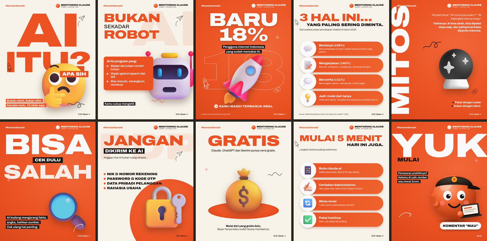

# 50 Carousel AI Sehari-hari · 5 tema × 10 slide

Gaya visual meniru poster referensi (tipografi raksasa yang terpotong, objek besar mengambang, kotak sorotan, doodle garis tangan, tekstur kertas), dengan **warna LP Mentoring Claude**: krem `#FBF7EE`, oranye `#F05323`, mangga `#F8A81B`, tinta `#191512`. Logo & maskot memakai merek sendiri (Si Bulat), bukan merek referensi.

| Tema | Untuk | Folder PNG (10 × 1080×1350) |
|---|---|---|
| 1 · AI Itu Apa Sih? `#KenalanSamaAI` | Orang yang penasaran & pemula | `png/tema-1-ai-itu-apa/` |
| 2 · Owner Pintar Pakai AI `#OwnerPakaiAI` | Pemilik usaha & UMKM | `png/tema-2-owner-pintar/` |
| 3 · AI di Hari-Hari `#AIDiRumah` | Kehidupan sehari-hari | `png/tema-3-ai-di-rumah/` |
| 4 · Prompt Itu Skill `#PromptItuSkill` | Yang hasil AI-nya masih biasa | `png/tema-4-prompt-itu-skill/` |
| 5 · Bikin Sendiri dengan Claude `#BikinSendiri` | Siap praktik → mentoring | `png/tema-5-bikin-sendiri/` |

Semua PNG dalam satu file: `carousel-ai-50-png.zip`. Caption + hashtag + sumber riset: [`CAPTION.md`](CAPTION.md).

## Mengubah isi
1. Edit teks di `data.js` (judul, kotak sorotan, daftar, sumber).
2. Pratinjau: buka `index.html` di Chrome (`index.html?tema=2` untuk satu tema).
3. Render ulang PNG: `node render.js` (atau `node render.js 2`). Butuh Node + Playwright.

## Mengganti ilustrasi dengan foto/3D realistis
Ilustrasi sekarang memakai Fluent Emoji 3D (Microsoft, lisensi MIT) karena generator gambar foto tidak tersedia di sini. Supaya lebih mirip referensi, buat gambar dengan AI gambar memakai [`PROMPT-GAMBAR.md`](PROMPT-GAMBAR.md), simpan PNG transparan sebagai `gambar/<id>.png`, lalu render ulang — otomatis menggantikan ilustrasi.

## Aset & lisensi
- Ilustrasi: [Fluent Emoji](https://github.com/microsoft/fluentui-emoji) (MIT) di `assets/emoji/`
- Huruf: Archivo variable (SIL OFL 1.1) di `assets/fonts/`
- Foto mentor: `assets/mentor-cutout.png` (dipotong dari foto LP, 320 px — ganti dengan foto beresolusi tinggi untuk hasil lebih tajam)
