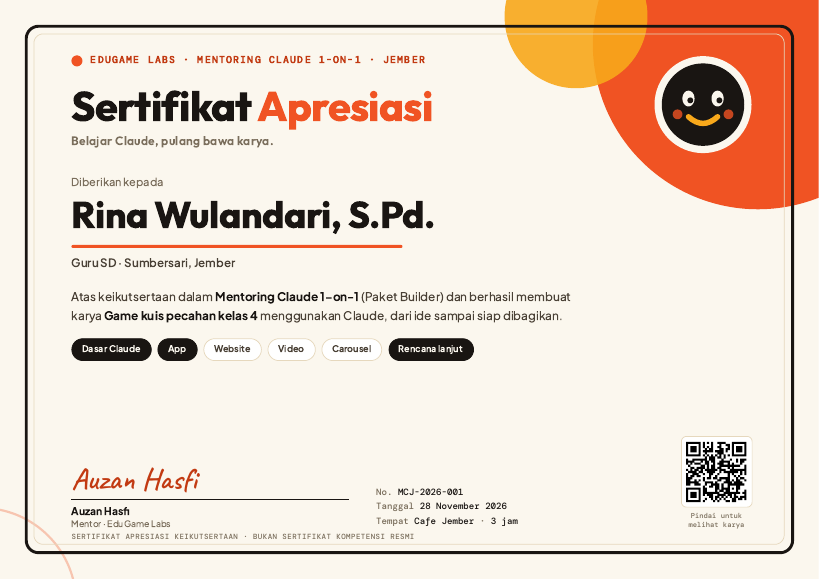

# Template Sertifikat Apresiasi · Mentoring Claude Jember

**Cara pakai**
1. Buka `index.html` di Chrome (laptop atau HP). Isi nama, bidang & asal, paket, karya, link karya (jadi QR), modul, tanggal, durasi, nomor urut.
2. Tekan **Cetak / Simpan PDF** → Tujuan *Simpan sebagai PDF*, Tata letak *Lanskap*, Margin *Tidak ada*, centang *Grafik latar belakang*.
3. Kirim PDF ke peserta lewat WhatsApp di H+0 (bersama ringkasan sesi).

**Banyak peserta (sesi grup):** buka "Banyak peserta sekaligus", tulis satu baris per orang: `nama;bidang & asal;karya;link`, tekan *Buat semua halaman*, lalu cetak. Hasilnya satu PDF dengan satu halaman per orang dan nomor berurutan (MCJ-2026-001, -002, …).

**Isi lewat link:** `index.html?nama=Rina%20Wulandari&asal=Guru%20SD&karya=Game%20kuis&paket=builder&tanggal=2026-11-28&modul=Dasar%20Claude,App` — tombol *Salin link isian* membuatnya otomatis.

**Catatan**
- QR dibuat di dalam file (tanpa internet). Font dari Google Fonts; kalau offline, huruf diganti font sistem.
- Nomor sertifikat dicatat di `tracker-leads.csv` (kolom catatan) supaya tidak dobel.
- Tulisannya **Sertifikat Apresiasi**, bukan sertifikat kompetensi resmi/terakreditasi. Jangan diubah jadi klaim resmi.
- Contoh: `contoh-sertifikat.pdf`, `contoh-3-peserta.pdf`.
